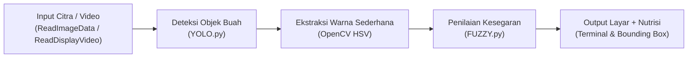

# SMART FRUIT SCANNER

## Sistem Deteksi Kematangan, Kesegaran, dan Informasi Nutrisi Buah
> **UAS Project AI** - Sistem Deteksi Sederhana Berbasis Modul Praktikum AI

---

## 1. Gambaran Sistem

Sistem berbasis AI yang mendeteksi jenis buah/sayuran serta memperkirakan tingkat kematangan dan kesegarannya melalui citra atau kamera secara real-time. Sistem juga menyajikan informasi nutrisi praktis untuk membantu konsumen awam memilih buah secara objektif.

Program ini menggabungkan dan mengintegrasikan seluruh materi modul praktikum ke dalam satu kesatuan sistem:
1. **Object Detection (YOLO)** - Deteksi objek buah dan pembuatan bounding box
2. **Computer Vision (OpenCV)** - Membaca citra gambar dan video stream kamera
3. **Fuzzy Logic (Scikit-Fuzzy)** - Sistem inferensi penentuan tingkat kesegaran
4. **Data Preprocessing & Knowledge Base** - Normalisasi fitur dan basis pengetahuan nutrisi edukatif

---

## 2. Alur Kerja Sistem



1. **Input**: Pengguna memasukkan file gambar, video, atau menyalakan kamera webcam (internal atau eksternal USB).
2. **Deteksi Objek (YOLO)**: Model YOLO mendeteksi letak buah dan menghasilkan bounding box serta confidence score. Objek selain buah (orang, kursi, hp, dll.) diabaikan.
3. **Ekstraksi Citra (OpenCV)**: Mengambil potongan area buah (ROI) dan menghitung nilai warna rata-rata (Hue, Saturation, Value).
4. **Fuzzy Logic (FUZZY.py)**: Mengolah indikator warna dan kondisi visual untuk menghasilkan skor kesegaran (0-100) dan menentukan kategori:
   - Skor >= 65: Segar Secara Visual [SEGAR] (Kotak Hijau)
   - Skor 40-64: Mulai Menurun [SEDANG] (Kotak Kuning)
   - Skor < 40: Terindikasi Busuk [BUSUK] (Kotak Merah)
5. **Output**: Menampilkan bounding box berwarna pada frame OpenCV dan mencetak laporan nutrisi ke terminal.

---

## 3. Komoditas yang Didukung (17 Kelas Dataset Roboflow)

Sistem mendukung seluruh 9 komoditas yang ada pada dataset:
- **Apel** (`fresh apple`, `rotten apple`, `apple`)
- **Pisang** (`fresh banana`, `rotten banana`, `banana`)
- **Paprika** (`fresh bellpepper`, `rottenbellpepper`)
- **Wortel** (`fresh carrot`, `rotten carrot`, `carrot`)
- **Mentimun** (`fresh cucumber`, `rotten cucumber`)
- **Mangga** (`fresh mango`, `rotten mango`)
- **Jeruk** (`fresh orange`, `rotten orange`, `orange`)
- **Kentang** (`fresh potato`, `rotten potato`)
- **Tomat** (`rotten tomato`)

---

## 4. Hubungan dengan Modul Praktikum

| Modul Praktikum | Fungsi yang Digunakan |
| :--- | :--- |
| `ReadImageData.py` | `cv2.imread()`, `cv2.imshow()`, `cv2.waitKey()`, `cv2.destroyAllWindows()` |
| `ReadDisplayVideo.py` | `cv2.VideoCapture()`, `while cap.isOpened()`, `ret, frame = cap.read()`, tombol `'q'` |
| `YOLO.py` | `YOLO("model.pt")`, `results = model(frame)`, loop `box in boxes`, `xyxy`, `cv2.rectangle`, `cv2.putText` |
| `FUZZY.py` | `ctrl.Antecedent`, `ctrl.Consequent`, `fuzz.trimf`, `ctrl.Rule`, `ctrl.ControlSystem`, `ctrl.ControlSystemSimulation` |

---

## 5. Basis Pengetahuan Nutrisi

Setiap buah yang terdeteksi secara otomatis dicocokkan dengan profil nutrisi:
- **Kalori**: Nilai energi per 100 gram
- **Kandungan Utama**: Vitamin, mineral, dan senyawa aktif
- **Khasiat**: Manfaat kesehatan bagi tubuh
- **Fase Kematangan**: Perubahan biokimia dari mentah ke matang
- **Tips Pemilihan**: Panduan visual bagi konsumen saat membeli

---

## 6. Model Training & Sample Images

### Status Model Training
Model yang digunakan adalah **YOLOv11** (`best_fruit.pt`) yang telah dilatih secara khusus:
- **Arsitektur**: YOLOv11 Nano fine-tuned pada 17 kelas komoditas buah & sayur.
- **Durasi Training**: 15 epoch pada GPU CUDA (mAP@50 mencapai ~69%, Precision 65%, Recall 71%).
- **Negative Background Suppression**: Dilatih dengan citra negatif latar ruangan (kursi, sofa, meja, lantai kayu) agar model tidak mengalami *false positive* (misal: kursi dikira kentang/pisang).
- **Status Bobot**: File `best_fruit.pt` sudah tersedia langsung di repository sehingga pengguna/penguji tidak perlu melatih ulang dari nol.

### Folder Contoh Gambar (`sample_images/`)
Dataset asli Roboflow berisi hampir 10.000 foto (>300 MB) sehingga sengaja tidak dimasukkan seluruhnya ke Git agar proses clone tetap ringan dan cepat. Sebagai gantinya, repository menyertakan folder **`sample_images/`** yang berisi 16 sampel gambar buah segar dan busuk siap uji (Apel, Pisang, Mentimun, Mangga, Jeruk, Wortel, Kentang, Paprika).

---

## 7. Perbandingan Versi Program

Repository ini menyediakan pilihan file eksekusi sesuai kebutuhan perangkat dan modul praktikum:

| Aspek | Versi 2 (`smart_fruit_scanner.py`) [Standar Praktikum] | Versi YOLO26 (`smart_fruit_scanner_yolo26.py`) [RTX 3050 & Dataset YOLO26] | Versi RTX 3050 (`smart_fruit_scanner_rtx.py`) [GPU Optimized] | Versi 1 (`smart_fruit_scanner_v1_preprocessing.py`) |
| :--- | :--- | :--- | :--- | :--- |
| **Target Hardware** | Laptop standar / CPU / iGPU | Dedicated GPU (NVIDIA RTX 3050 4GB) | Dedicated GPU (NVIDIA RTX 3050 4GB) | Laptop standar / CPU |
| **Model YOLO** | YOLOv11 (`best_fruit.pt`) | **YOLO26** (`yolo26m.pt` / `best_yolo26_fruit.pt`) | YOLOv11 (`best_fruit.pt` + CUDA) | YOLOv8n Roboflow dasar |
| **Gunakan best_fruit.pt?** | Ya | **Tidak** (Murni arsitektur YOLO26 baru) | Ya | Tidak (model lama) |
| **Fitur Training Menu** | Tidak ada | **Tersedia (Menu 5)**: Train dataset langsung via GPU RTX 3050 | Tidak ada | Tidak ada |
| **Menu Scan Gambar** | Pilihan preset + custom | **1 Pilihan Langsung**: Input path kustom | **1 Pilihan Langsung**: Input path kustom | Otomatis ambil sampel / custom |
| **Akselerasi CUDA** | Auto-detect (CPU/CUDA) | Dioptimalkan khusus GPU RTX 3050 | Dioptimalkan khusus GPU RTX 3050 | Auto-detect (CPU/CUDA) |
| **File Eksekusi** | `smart_fruit_scanner.py` | `smart_fruit_scanner_yolo26.py` | `smart_fruit_scanner_rtx.py` | `smart_fruit_scanner_v1_preprocessing.py` |

---

## 8. Cara Menjalankan Program

### Menjalankan Versi YOLO26 (Murni Model YOLO26, Tanpa best_fruit.pt, Fitur Training GPU)
Khusus untuk pengguna yang mengunduh dataset format YOLO26 dan menggunakan GPU RTX 3050:
```powershell
python smart_fruit_scanner_yolo26.py
```

### Menjalankan Versi GPU RTX 3050 (Akselerasi Tinggi & Custom Image Langsung)
Cocok untuk pengguna laptop dengan GPU NVIDIA RTX 3050 4GB:
```powershell
python smart_fruit_scanner_rtx.py
```

### Menjalankan Versi Standar Praktikum (CPU / All Laptop)
```powershell
python smart_fruit_scanner.py
```

### Menjalankan Versi 1 (Dengan Modul Preprocessing sklearn)
```powershell
python smart_fruit_scanner_v1_preprocessing.py
```

Pilihan menu yang tersedia di kedua versi:
- **[1] Scan dari Gambar**: Membaca gambar dengan pilihan preset contoh dataset atau path file kustom.
- **[2] Scan dari Video**: Membaca dan menganalisis file video buah frame-by-frame.
- **[3] Scan dari Webcam Laptop**: Deteksi real-time menggunakan kamera bawaan laptop (indeks 0).
- **[4] Scan dari Kamera Eksternal**: Deteksi real-time menggunakan kamera USB eksternal (indeks 1 atau indeks kustom).
- **[0] Keluar**: Menutup aplikasi.

---

*Repository GitHub: [khazennn234-gif/UAS-PROJECT-AI](https://github.com/khazennn234-gif/UAS-PROJECT-AI)*
