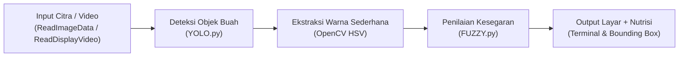

# SMART FRUIT SCANNER

## Sistem Deteksi Kematangan, Kesegaran, dan Informasi Nutrisi Buah
> **UAS Project AI** - Sistem Deteksi Sederhana Berbasis Modul Praktikum AI

---

## 1. Gambaran Sistem

Sistem berbasis AI yang mendeteksi jenis buah/sayuran serta memperkirakan tingkat kematangan dan kesegarannya melalui citra atau kamera secara real-time. Sistem juga menyajikan informasi nutrisi praktis untuk membantu konsumen awam memilih buah secara objektif.

Program ini dirancang langsung berdasarkan hasil codingan modul praktikum:
1. **YOLO.py** - Deteksi objek dan pembuatan bounding box
2. **ReadImageData.py** - Membaca dan menampilkan citra dengan OpenCV
3. **ReadDisplayVideo.py** - Membaca aliran frame video dan kamera langsung
4. **FUZZY.py** - Sistem inferensi Fuzzy Logic (Antecedent, Consequent, Rules)

---

## 2. Alur Kerja Sistem



1. **Input**: Pengguna memasukkan file gambar, video, atau menyalakan kamera webcam (internal atau eksternal USB).
2. **Deteksi Objek (YOLO)**: Model YOLO mendeteksi letak buah dan menghasilkan bounding box serta confidence score. Objek selain buah (orang, kursi, hp, dll.) diabaikan.
3. **Ekstraksi Citra (OpenCV)**: Mengambil potongan area buah (ROI) dan menghitung nilai warna rata-rata (Hue, Saturation, Value).
4. **Fuzzy Logic (FUZZY.py)**: Mengolah indikator warna dan kondisi visual untuk menghasilkan skor kesegaran (0-100) dan menentukan kategori:
   - Skor >= 65: Segar Secara Visual [SEGAR] (Kotak Hijau)
   - Skor 40-64: Mulai Menurun [SEDANG] (Kotak Kuning)
   - Skor < 40: Terindikasi Busuk [BUSUK] (Kotak Merah)
5. **Output**: Menampilkan bounding box berwarna pada frame OpenCV dan mencetak laporan nutrisi ke terminal.

---

## 3. Komoditas yang Didukung (17 Kelas Dataset Roboflow)

Sistem mendukung seluruh 9 komoditas yang ada pada dataset:
- **Apel** (`fresh apple`, `rotten apple`, `apple`)
- **Pisang** (`fresh banana`, `rotten banana`, `banana`)
- **Paprika** (`fresh bellpepper`, `rottenbellpepper`)
- **Wortel** (`fresh carrot`, `rotten carrot`, `carrot`)
- **Mentimun** (`fresh cucumber`, `rotten cucumber`)
- **Mangga** (`fresh mango`, `rotten mango`)
- **Jeruk** (`fresh orange`, `rotten orange`, `orange`)
- **Kentang** (`fresh potato`, `rotten potato`)
- **Tomat** (`rotten tomato`)

---

## 4. Hubungan dengan Modul Praktikum

| Modul Praktikum | Fungsi yang Digunakan |
| :--- | :--- |
| `ReadImageData.py` | `cv2.imread()`, `cv2.imshow()`, `cv2.waitKey()`, `cv2.destroyAllWindows()` |
| `ReadDisplayVideo.py` | `cv2.VideoCapture()`, `while cap.isOpened()`, `ret, frame = cap.read()`, tombol `'q'` |
| `YOLO.py` | `YOLO("model.pt")`, `results = model(frame)`, loop `box in boxes`, `xyxy`, `cv2.rectangle`, `cv2.putText` |
| `FUZZY.py` | `ctrl.Antecedent`, `ctrl.Consequent`, `fuzz.trimf`, `ctrl.Rule`, `ctrl.ControlSystem`, `ctrl.ControlSystemSimulation` |

---

## 5. Basis Pengetahuan Nutrisi

Setiap buah yang terdeteksi secara otomatis dicocokkan dengan profil nutrisi:
- **Kalori**: Nilai energi per 100 gram
- **Kandungan Utama**: Vitamin, mineral, dan senyawa aktif
- **Khasiat**: Manfaat kesehatan bagi tubuh
- **Fase Kematangan**: Perubahan biokimia dari mentah ke matang
- **Tips Pemilihan**: Panduan visual bagi konsumen saat membeli

---

## 6. Perbandingan 2 Versi Program

Untuk memenuhi kebutuhan laporan, demo, serta keselarasan modul praktikum, repository ini menyediakan **2 versi program**:

| Aspek | Versi 1 (`smart_fruit_scanner_v1_preprocessing.py`) | Versi 2 (`smart_fruit_scanner.py`) [Rekomendasi Praktikum] |
| :--- | :--- | :--- |
| **Fokus Desain** | Mengikuti proposal awal dengan modul preprocessing lengkap | Murni selaras dengan codingan modul praktikum AI |
| **Modul Preprocessing** | Menggunakan `sklearn.preprocessing.MinMaxScaler` & varians tekstur | Sederhana langsung via OpenCV (HSV) tanpa library `sklearn` |
| **Model YOLO** | YOLOv8n Roboflow (Threshold 0.25) | YOLOv11 (`best_fruit.pt`) dengan Background Negative Suppression |
| **Anti False-Positive** | Rentan salah deteksi pada perabot ruangan (kursi/sofa) | Telah dilatih mengenali latar ruangan/kursi sehingga tidak salah deteksi |
| **Gaya Kode & Output** | Disertai emoji dan visualisasi terminal berwarna | 100% bebas emoji, format teks rapi dan bersih standar praktikum |
| **File Eksekusi** | `smart_fruit_scanner_v1_preprocessing.py` | `smart_fruit_scanner.py` |

---

## 7. Cara Menjalankan Program

### Menjalankan Versi 2 (Praktikum Murni & YOLOv11 Anti False-Positive)
```powershell
python smart_fruit_scanner.py
```

### Menjalankan Versi 1 (Dengan Modul Preprocessing sklearn)
```powershell
python smart_fruit_scanner_v1_preprocessing.py
```

Pilihan menu yang tersedia di kedua versi:
- **[1] Scan dari Gambar**: Membaca gambar dengan pilihan preset contoh dataset atau path file kustom.
- **[2] Scan dari Video**: Membaca dan menganalisis file video buah frame-by-frame.
- **[3] Scan dari Webcam Laptop**: Deteksi real-time menggunakan kamera bawaan laptop (indeks 0).
- **[4] Scan dari Kamera Eksternal**: Deteksi real-time menggunakan kamera USB eksternal (indeks 1 atau indeks kustom).
- **[0] Keluar**: Menutup aplikasi.

---

*Repository GitHub: [khazennn234-gif/UAS-PROJECT-AI](https://github.com/khazennn234-gif/UAS-PROJECT-AI)*
