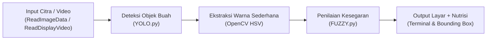

# SMART FRUIT SCANNER

## Sistem Deteksi Kematangan, Kesegaran, dan Informasi Nutrisi Buah
> **UAS Project AI** — Sistem Deteksi Sederhana Berbasis Modul Praktikum AI

---

## 1. Gambaran Sistem

Sistem berbasis AI yang mendeteksi jenis buah/sayuran serta memperkirakan tingkat kematangan dan kesegarannya melalui citra atau kamera secara *real-time*. Sistem juga menyajikan informasi nutrisi praktis untuk membantu konsumen awam memilih buah secara objektif.

Program ini dirancang langsung berdasarkan hasil codingan modul praktikum:
1. **YOLO.py** — Deteksi objek dan pembuatan *bounding box*
2. **ReadImageData.py** — Membaca dan menampilkan citra dengan OpenCV
3. **ReadDisplayVideo.py** — Membaca aliran frame video dan kamera langsung
4. **FUZZY.py** — Sistem inferensi Fuzzy Logic (Antecedent, Consequent, Rules)

---

## 2. Alur Kerja Sistem



1. **Input**: Pengguna memasukkan file gambar, video, atau menyalakan kamera webcam.
2. **Deteksi Objek**: Model YOLO mendeteksi letak buah dan menghasilkan bounding box serta confidence score.
3. **Ekstraksi Citra**: OpenCV membaca area potongan buah (ROI) dan menghitung rata-rata nilai warna (Hue).
4. **Fuzzy Logic**: Mengolah skor warna dan kondisi visual objek untuk menghasilkan skor kesegaran (0-100).
5. **Output**: Menampilkan bounding box pada jendela citra OpenCV serta mencetak laporan nutrisi ke terminal.

---

## 3. Komoditas yang Didukung (17 Kelas Dataset Roboflow)

Sistem mendukung seluruh 9 komoditas yang ada pada dataset:
- **Apel** (`fresh apple`, `rotten apple`, `apple`)
- **Pisang** (`fresh banana`, `rotten banana`, `banana`)
- **Paprika** (`fresh bellpepper`, `rottenbellpepper`)
- **Wortel** (`fresh carrot`, `rotten carrot`)
- **Mentimun** (`fresh cucumber`, `rotten cucumber`)
- **Mangga** (`fresh mango`, `rotten mango`)
- **Jeruk** (`fresh orange`, `rotten orange`, `orange`)
- **Kentang** (`fresh potato`, `rotten potato`)
- **Tomat** (`rotten tomato`)

---

## 4. Hubungan dengan Modul Praktikum

| Modul Praktikum | Bagian yang Digunakan |
| :--- | :--- |
| `ReadImageData.py` | `cv2.imread()`, `cv2.imshow()`, `cv2.waitKey()`, `cv2.destroyAllWindows()` |
| `ReadDisplayVideo.py` | `cv2.VideoCapture()`, `while cap.isOpened()`, `ret, frame = cap.read()`, tombol `'q'` |
| `YOLO.py` | `YOLO("yolov8n.pt")`, `results = model(frame)`, loop `box in boxes`, koordinat `xyxy`, `cv2.rectangle`, `cv2.putText` |
| `FUZZY.py` | `ctrl.Antecedent`, `ctrl.Consequent`, `fuzz.trimf`, `ctrl.Rule`, `ctrl.ControlSystem`, `ctrl.ControlSystemSimulation` |

---

## 5. Cara Menjalankan Program

Jalankan skrip utama pada terminal:

```powershell
python smart_fruit_scanner.py
```

Pilihan menu yang tersedia:
- **[1] Scan dari Gambar**: Membaca dan menganalisis file citra foto buah.
- **[2] Scan dari Video**: Membaca file rekaman video buah frame-by-frame.
- **[3] Scan dari Webcam**: Deteksi langsung secara real-time melalui kamera laptop.
- **[0] Keluar**: Menutup aplikasi.

---

*Repository GitHub: [khazennn234-gif/UAS-PROJECT-AI](https://github.com/khazennn234-gif/UAS-PROJECT-AI)*
