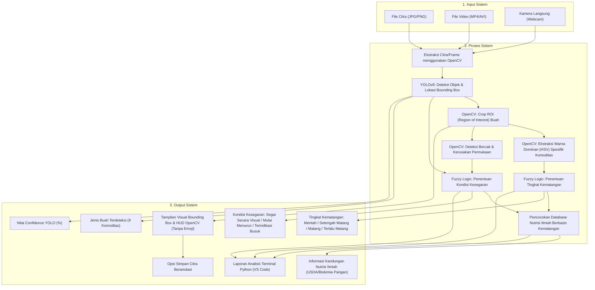

# SMART FRUIT SCANNER

## Sistem Deteksi Kematangan, Kesegaran, dan Informasi Nutrisi Buah & Sayuran
> **UAS Project AI** — Penilai Kesegaran dan Kematangan Objektif untuk Konsumen Awam

---

## Ringkasan Proyek

| Parameter | Keterangan |
| :--- | :--- |
| **Urgensi** | Konsumen awam sering kesulitan membedakan tingkat kematangan dan kesegaran buah, sehingga rentan tertipu pedagang nakal atau salah memilih buah yang sesuai kebutuhan nutrisi. |
| **Pembeda** | **Penilaian objektif berbasis fitur citra** (analisis spektrum warna HSV spesifik komoditas, persentase bercak/cacat permukaan, dan deteksi YOLO), **bukan perasaan penjual**. Dilengkapi edukasi profil nutrisi adaptif berdasarkan fase kematangan buah. |
| **Teknologi Utama** | **YOLOv8** (Deteksi Objek) + **OpenCV** (Akuisisi Frame & Ekstraksi Fitur Visual) + **Fuzzy Logic** (Otak Penilai Kematangan & Kesegaran). |
| **Cakupan Komoditas** | Mendukung seluruh 9 komoditas dari dataset: **Apel, Pisang, Paprika, Wortel, Mentimun, Mangga, Jeruk, Kentang, Tomat** (17 kelas deteksi: fresh & rotten). |
| **Catatan Revisi** | **Modul Preprocessing Data (scikit-learn) ditiadakan**. Pemrosesan citra, ekstraksi ROI, analisis warna, serta deteksi bercak kerusakan ditangani secara terintegrasi menggunakan **OpenCV**. Di codingan tidak menggunakan karakter emoji. |

---

## A. Alur Input dan Output Sistem



### 1. Input Sistem
- Pengguna dapat memasukkan gambar buah melalui file gambar statis (`.jpg`, `.jpeg`, `.png`).
- Pengguna dapat memasukkan file video (`.mp4`, `.avi`) atau mengaktifkan kamera secara langsung (*real-time webcam*).
- Sistem menerima citra sebagai matriks piksel BGR yang siap dianalisis.
- Jika input berupa video, sistem mengekstrak video menjadi aliran *frame-by-frame* menggunakan pustaka `cv2.VideoCapture` dari OpenCV.

### 2. Proses Sistem
- **Akuisisi Frame**: Gambar atau frame video diproses menggunakan OpenCV.
- **Deteksi Objek YOLO**: Model YOLO mendeteksi jenis buah dan menentukan koordinat spasial objek melalui *bounding box* `(x1, y1, x2, y2)`.
- **Ekstraksi ROI (Region of Interest)**: OpenCV mengambil area buah secara spesifik untuk memisahkan objek dari latar belakang.
- **Analisis Karakteristik Visual (OpenCV)**:
  - *Spektrum Warna*: Analisis kanal Hue & Saturation (HSV) yang disesuaikan dengan karakteristik komoditas:
    - *Pisang, Mangga, Tomat, Apel, Jeruk, Paprika*: Hijau = mentah, Kuning/Merah/Oranye = matang.
    - *Mentimun*: Hijau pekat = matang segar, Menguning = lewat matang.
    - *Kentang*: Cokelat muda = segar/matang, Kehijauan = solanin/rusak.
    - *Wortel*: Oranye cerah = matang segar.
  - *Deteksi Bercak & Cacat Permukaan*: Menggunakan segmentasi thresholding dan analisis kontur piksel gelap untuk mengukur persentase luas bercak kerusakan pada kulit buah.
- **Inferensi Fuzzy Logic (Mamdani)**:
  - *Sistem Fuzzy Kematangan*: Mengolah indikator warna dominan untuk menghasilkan skor dan status kematangan.
  - *Sistem Fuzzy Kesegaran*: Mengolah persentase bercak kerusakan, nilai confidence deteksi, dan status kematangan untuk menghasilkan skor serta kondisi kesegaran.
- **Integrasi Database Nutrisi**: Sistem mencocokkan jenis buah dan tingkat kematangannya dengan basis data nutrisi ilmiah, karena profil biokimia buah (gula, vitamin C, pektin, pati resisten) berubah drastis seiring bertambahnya kematangan.

### 3. Output Sistem
1. **Jenis Buah**: Menampilkan komoditas yang terdeteksi dari 9 buah dataset (Apel, Pisang, Paprika, Wortel, Mentimun, Mangga, Jeruk, Kentang, Tomat).
2. **Nilai Confidence YOLO**: Tingkat kepastian model deteksi dalam persentase (misal: `94.5%`).
3. **Tingkat Kematangan**: Klasifikasi 4 tahap:
   - `Mentah`
   - `Setengah Matang`
   - `Matang`
   - `Terlalu Matang`
4. **Kondisi Kesegaran**: Klasifikasi 3 status:
   - `Segar Secara Visual` `[SEGAR]`
   - `Mulai Menurun` `[SEDANG]`
   - `Terindikasi Busuk` `[BUSUK]`
5. **Informasi Nutrisi & Karakteristik Ilmiah**: Kandungan energi (kalori), gula, serat pangan, vitamin C, manfaat kesehatan, serta rekomendasi konsumsi sesuai tingkat kematangan.
6. **Laporan Terminal Python**: Rangkuman terstruktur yang rapi di terminal VS Code bebas emoji.
7. **Penyimpanan Gambar**: Opsi otomatis/interaktif untuk menyimpan file gambar yang telah diberi *bounding box* dan label ke folder lokal.

---

## B. Tahapan Pembuatan Sistem

### 1. Perencanaan dan Penentuan Objek Penelitian
- Menentukan objek analisis: Seluruh 9 varietas buah dan sayuran yang ada pada dataset (Apel, Pisang, Paprika, Wortel, Mentimun, Mangga, Jeruk, Kentang, Tomat).
- Menetapkan 4 kategori tingkat kematangan (*Mentah*, *Setengah Matang*, *Matang*, *Terlalu Matang*) dan 3 kategori kesegaran (*Segar Secara Visual*, *Mulai Menurun*, *Terindikasi Busuk*).
- Menetapkan batasan sistem: Berjalan secara lokal pada Python 3.10+ dengan terminal antarmuka interaktif dan jendela tampilan visual OpenCV tanpa penggunaan emoji.

### 2. Pengumpulan Dataset Gambar dan Video
- Mengumpulkan citra dan video dengan variasi pencahayaan, sudut pengambilan, serta latar belakang yang bervariasi.
- Menggunakan dataset komprehensif **Freshness Fruits and Vegetables v7** (9.283 gambar beranotasi: 6.489 train, 1.849 valid, 945 test).
- Memastikan dataset mencakup kondisi segar (*fresh*) dan rusak/busuk (*rotten*).

### 3. Labelling Data
- Anotasi citra menggunakan format standar YOLO (koordinat normalisasi `class_id x_center y_center width height`).
- Dataset telah dilabeli untuk 17 kelas objek yang mencakup seluruh 9 komoditas:
  ```yaml
  names: [
    'fresh apple', 'fresh banana', 'fresh bellpepper', 'fresh carrot',
    'fresh cucumber', 'fresh mango', 'fresh orange', 'fresh potato',
    'rotten apple', 'rotten banana', 'rotten carrot', 'rotten cucumber',
    'rotten mango', 'rotten orange', 'rotten potato', 'rotten tomato',
    'rottenbellpepper'
  ]
  ```

> [!NOTE]
> **Catatan Tahapan 4 (Revisi Kelompok)**: Modul *Preprocessing Data* berbasis scikit-learn (Min-Max scaler, binarizer terpisah) tidak digunakan. Pengolahan citra dilakukan secara langsung dan dinamis oleh OpenCV pada Tahapan 6.

### 5. Training dan Pengembangan Model YOLO
- Memilih arsitektur dasar **YOLOv8** (`yolov8n.pt`) untuk kecepatan inferensi *real-time* yang optimal pada perangkat konsumen awam.
- Konfigurasi pelatihan menggunakan file `data.yaml`.
- Model mendeteksi bounding box sekaligus mengenali label awal kesegaran umum untuk memandu analisis lanjutan.

### 6. Ekstraksi Karakteristik Visual Menggunakan OpenCV
Tanpa bergantung pada preprocessing manual eksternal, OpenCV langsung mengekstrak dua indikator penting dari area buah (*ROI*):
1. **Analisis Indeks Warna Kematangan (HSV)**:
   - Citra BGR dikonversi ke ruang warna HSV (*Hue, Saturation, Value*).
   - Menghitung rasio piksel spektrum hijau berbanding spektrum kuning/merah/oranye sesuai biologi tanaman buah masing-masing.
   - Menghasilkan nilai kuantitatif `indeks_kematangan_warna` ($0 - 100$).
2. **Deteksi Bercak & Cacat Permukaan (Defect Analysis)**:
   - ROI dikonversi ke Grayscale dan difilter Gaussian.
   - Mengaplikasikan *thresholding* dan operasi morfologi untuk mengisolasi area bintik hitam, nekrosis kulit, atau memar.
   - Menghitung persentase luas bercak cacat terhadap total luas ROI buah ($0 - 100\%$).

### 7. Implementasi Fuzzy Logic
Menggunakan pustaka `scikit-fuzzy` dengan metode inferensi Mamdani:

#### A. Fuzzy Kematangan Buah
- **Input**: `Indikator Warna` ($0 - 100$)
  - *Hijau / Mentah*: $[0, 0, 40]$
  - *Transisi Kuning*: $[25, 45, 65]$
  - *Kuning-Merah / Matang*: $[50, 70, 85]$
  - *Kecokelatan / Terlalu Matang*: $[75, 100, 100]$
- **Output**: `Tingkat Kematangan` ($0 - 100$)
  - *Mentah*: $[0, 0, 35]$ (Skor $< 35$)
  - *Setengah Matang*: $[25, 45, 65]$ (Skor $35 - 55$)
  - *Matang*: $[55, 75, 90]$ (Skor $55 - 80$)
  - *Terlalu Matang*: $[75, 100, 100]$ (Skor $> 80$)

#### B. Fuzzy Kesegaran Buah
- **Input**:
  - `Persentase Bercak` ($0 - 100$): *Rendah* ($0-25$), *Sedang* ($20-70$), *Tinggi* ($55-100$).
  - `Confidence YOLO` ($0 - 100$): *Rendah* ($0-50$), *Sedang* ($35-85$), *Tinggi* ($70-100$).
- **Output**: `Kondisi Kesegaran` ($0 - 100$)
  - *Terindikasi Busuk*: $[0, 0, 40]$ (Skor $< 40$)
  - *Mulai Menurun*: $[30, 55, 75]$ (Skor $40 - 65$)
  - *Segar Secara Visual*: $[65, 100, 100]$ (Skor $> 65$)

### 8. Pembuatan Database Informasi Nutrisi
Mencakup seluruh 9 komoditas yang disusun berdasarkan referensi ilmiah biokimia pangan (data USDA FoodData Central & jurnal nutrisi pangan):
1. **Pisang** (*Musa paradisiaca*): Mentah (tinggi resistant starch) s/d Terlalu Matang (antioksidan TNF).
2. **Apel** (*Malus domestica*): Mentah (tinggi asam malat) s/d Matang (serat larut pektin & quercetin).
3. **Tomat** (*Solanum lycopersicum*): Mentah (tomatine) s/d Matang (likopen bioaktif maksimal).
4. **Mangga** (*Mangifera indica*): Mentah (asam alami & vit C) s/d Matang (mangiferin & beta-karoten).
5. **Jeruk** (*Citrus sinensis*): Mentah (asam sitrat) s/d Matang (asam askorbat & hesperidin).
6. **Paprika** (*Capsicum annuum*): Mentah (klorofil segar) s/d Matang (vitamin C 127 mg).
7. **Mentimun** (*Cucumis sativus*): Mentah s/d Matang (95% air mineral silika).
8. **Wortel** (*Daucus carota*): Mentah s/d Matang (beta-karoten pro-vitamin A).
9. **Kentang** (*Solanum tuberosum*): Mentah s/d Matang (karbohidrat kompleks & kalium).

### 9. Integrasi dan Pembuatan Program Utama
- Seluruh subsistem (OpenCV, YOLO, skfuzzy, dan Database Nutrisi) dipadukan ke dalam satu file skrip: [`smart_fruit_scanner.py`](file:///c:/Users/ADVAN/Documents/PRAKTIKUM/AI/UAS%20PROJECT%20AI/smart_fruit_scanner.py).
- Antarmuka terminal interaktif CLI yang bersih tanpa emoji.

### 10. Pengujian dan Evaluasi Sistem
- Verifikasi uji mandiri fungsi visual dan logika Fuzzy.
- Pengujian deteksi citra tunggal dengan opsi penyimpanan hasil bounding box.
- Pengujian aliran video dan deteksi webcam real-time.

---

## C. Cara Menjalankan

### 1. Instalasi Pustaka Pendukung
```bash
pip install ultralytics torch torchvision opencv-python numpy scikit-fuzzy
```

### 2. Menjalankan Aplikasi
```powershell
python smart_fruit_scanner.py
```

Pilihan menu yang tersedia:
- Ketik `1` untuk melatih model YOLO pada dataset.
- Ketik `2` untuk scan gambar dan menyimpan hasil anotasi.
- Ketik `3` untuk scan rekaman video buah.
- Ketik `4` untuk scan langsung lewat webcam kamera.
- Ketik `5` untuk uji cepat demonstrasi integrasi sistem (9 buah, OpenCV, Fuzzy, Nutrisi).
- Ketik `0` untuk keluar.
